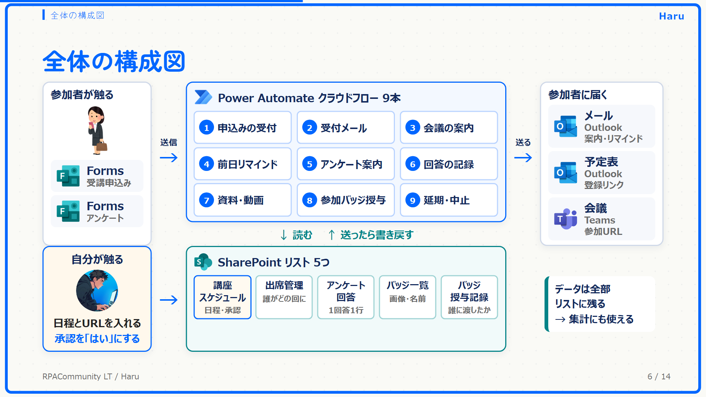

# 講座運営 自動化キット（Power Automate）

受講申込みから参加バッジの授与まで、講座の運営で毎回発生する連絡と記録を、Power Automate のクラウドフローで自動化するキットです。

2026年10月19日の RPACommunity「Power Automate スペシャル！ライトニングトーク会」での LT「受講申込みから参加バッジの授与まで、Power Automate 講座の運営をクラウドフローで自動化した話」の配布物です。

## 入っているもの

| 置き場所 | 中身 |
|---|---|
| `solution/KozaOpsKit.zip` | ソリューション一式（クラウドフロー10本・接続参照3つ・環境変数3つ） |
| `docs/setup.md` | 導入手順（リスト作成 → Forms 作成 → インポート → オンにする） |
| `docs/design.md` | 設計の説明（リストの列・送る条件・二重防止・承認を人に残す理由） |
| `forms/questions.md` | Forms 2つの質問の作り方 |
| `solution/KozaOpsKit.settings.sample.json` | pac CLI でインポートする人向けの設定ファイルの見本 |

## フロー10本

| No | フロー | きっかけ | やること |
|---|---|---|---|
| 00 | リストを作る | 手動（最初に1回） | SharePoint リスト5つと列を作る |
| 01 | 申込みの受付 | Forms（申込み）の送信 | 出席管理に1行追加。申込キーで二重登録しない |
| 02 | 受付メール | 1時間ごと | 受付メール未送信の人に、予定表の登録リンク付きで送る |
| 03 | 会議の案内 | 毎日 8:00 | 開催予定で会議URLが入った回の出席者に、参加URLを送る |
| 04 | 前日リマインド | 毎日 9:00 | 明日開催の回の出席者に送る |
| 05 | アンケート案内 | 毎日 10:00 | 開催済み・承認済み・URLありの回の出席者に送る |
| 06 | 回答の記録 | Forms（アンケート）の送信 | アンケート回答に1行追加。回答キーで二重登録しない |
| 07 | 資料・動画の公開 | 毎日 11:00 | 開催済み・承認済み・資料URLありの回の出席者に送る |
| 08 | 参加バッジ授与 | 1時間ごと | 回答した人に、その回のバッジを1回だけ送る |
| 09 | 延期・中止の連絡 | 毎日 12:00 | 延期・中止で承認済みの回の出席者に送る |

送る系のフローは、どれも同じ考え方で作っています。

- 送る条件は日時ではなく、リストの状態の列で決める
- 送ったら、すぐに送信済みの列を「はい」に書き戻す（何回実行しても1回しか送らない）
- 人が触るのは、講座スケジュールに日程とURLを入れることと、配信承認を「はい」にすることだけ

## 必要なもの

- Microsoft 365 の職場または学校のアカウント（Forms の回答者のメールアドレスを使うため）
- Power Automate（Office 365 Outlook・SharePoint・Microsoft Forms は標準コネクタ）
- SharePoint サイト（リストを置く場所）
- ソリューションを扱える Power Platform の環境

## 始め方

1. `solution/KozaOpsKit.zip` をダウンロードする
2. [docs/setup.md](docs/setup.md) の手順でインポートし、「00 リストを作る」を1回実行する
3. Forms を2つ作り、フォームIDを環境変数に入れて、01〜09 をオンにする

## 動作確認の状況（2026-10-19 時点）

| 対象 | 状況 |
|---|---|
| ソリューションのインポート | 確認済み（環境変数・接続参照つき） |
| 00 リストを作る | 確認済み（リスト5つと列が作られる） |
| 02〜05・07〜09 | 確認中 |
| 01・06（Forms） | 未確認 |

確認が進んだら、この表を更新します。

## 注意

- インポートしたフローはオフの状態で入ります。動かすには、各フローを開いて「オンにする」を押す必要があります。
- メールはインポートした人の Outlook から送られます。最初は自分だけを出席者にして試すと安全です。
- 個人の検証環境で作ったサンプルです。本番で使う前に、自分の環境で動作を確かめる前提です。
- 本キットの利用によって生じた結果について、作者は責任を負いません。

作者：Haru（X：[@isamu_Automate](https://x.com/isamu_Automate)）／ Power Automate 45分講座 [PA45](https://powerautomate-create.connpass.com/)
