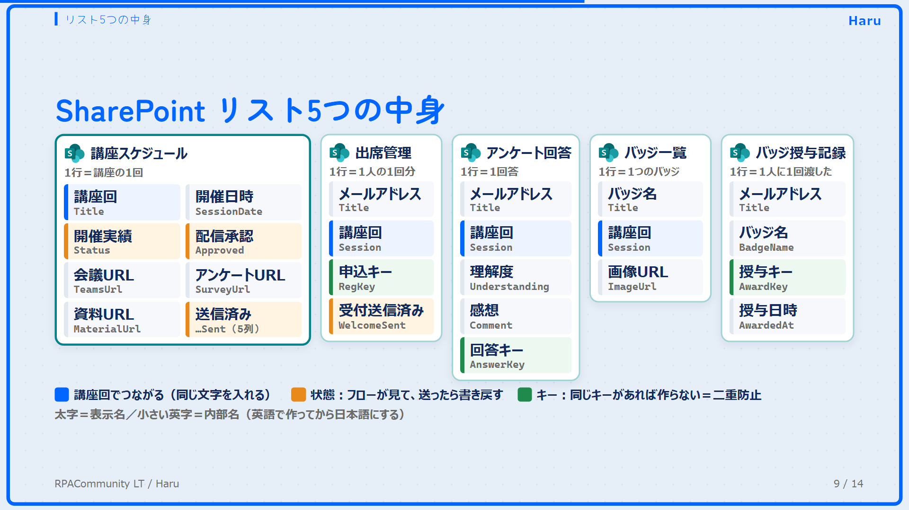
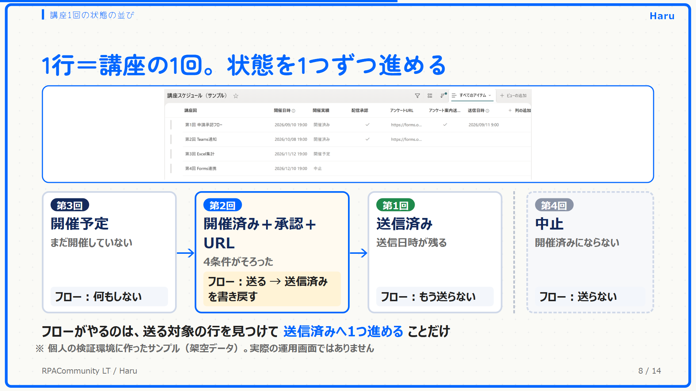

# 設計の説明

## 全体の構成

- 参加者が触るのは Forms の2つ（申込み・アンケート）
- クラウドフロー9本が SharePoint のリスト5つを読み、送ったら書き戻す
- 参加者に届くのは Outlook のメールと、予定表の登録リンク、Teams 会議の参加URL
- 運営者が触るのは、講座スケジュールに日程とURLを入れることと、配信承認を「はい」にすることだけ

## リスト5つの列

| リスト | 内部名 | 表示名 | 種類 | 役割 |
|---|---|---|---|---|
| 講座スケジュール | Title | 講座回 | テキスト | ほかのリストとつなぐ文字 |
| | SessionDate | 開催日時 | 日付と時刻 | |
| | Status | 開催実績 | 選択肢（開催予定・開催済み・延期・中止） | 状態 |
| | Approved | 配信承認 | はい/いいえ | 状態（人が決める） |
| | TeamsUrl | 会議URL | テキスト | |
| | SurveyUrl | アンケートURL | テキスト | |
| | MaterialUrl | 資料URL | テキスト | |
| | InviteSent | 会議案内_送信済み | はい/いいえ | 状態（03 が書く） |
| | ReminderSent | リマインド_送信済み | はい/いいえ | 状態（04 が書く） |
| | SurveySent | アンケート案内_送信済み | はい/いいえ | 状態（05 が書く） |
| | MaterialSent | 資料案内_送信済み | はい/いいえ | 状態（07 が書く） |
| | NoticeSent | 延期中止_送信済み | はい/いいえ | 状態（09 が書く） |
| 出席管理 | Title | メールアドレス | テキスト | |
| | Session | 講座回 | テキスト | 講座スケジュールとつなぐ |
| | RegKey | 申込キー | テキスト | 講座回｜メール。二重登録を防ぐ |
| | WelcomeSent | 受付メール_送信済み | はい/いいえ | 状態（02 が書く） |
| アンケート回答 | Title | メールアドレス | テキスト | |
| | Session | 講座回 | テキスト | |
| | Understanding | 理解度 | テキスト | |
| | Comment | 感想 | 複数行テキスト | |
| | AnswerKey | 回答キー | テキスト | 講座回｜メール。二重登録を防ぐ |
| バッジ一覧 | Title | バッジ名 | テキスト | |
| | Session | 講座回 | テキスト | どの回のバッジか |
| | ImageUrl | 画像URL | テキスト | |
| バッジ授与記録 | Title | メールアドレス | テキスト | |
| | BadgeName | バッジ名 | テキスト | |
| | AwardKey | 授与キー | テキスト | バッジ名｜メール。二重授与を防ぐ |
| | AwardedAt | 授与日時 | 日付と時刻 | |

リスト同士は、参照列ではなく「講座回」という同じ文字の列でつないでいます。フィルター（`Session eq '第1回 …'`）がそのまま書けて、フローが読みやすいためです。

## 送る条件は、日時ではなく状態で決める

「開催日の翌日にアンケートを送る」のように日時で書くと、次のことが起きます。

- 中止になった回にも送る
- URLの準備が間に合っていなくても送る
- フローを再実行すると二重に送る

そこで、アンケート案内（05）は次の4つがすべてそろった回にだけ送ります。

1. 開催実績が「開催済み」
2. 配信承認が「はい」
3. アンケートURLが入っている
4. アンケート案内_送信済みが「いいえ」

送ったら、すぐにアンケート案内_送信済みを「はい」に書き戻します。フローは毎日動きますが、同じ回に2回送ることはありません。03・04・07・09 も同じ形です。

## 二重に登録しない・二重に渡さない

| 場所 | キー | 効果 |
|---|---|---|
| 出席管理（01） | 講座回｜メールアドレス | 同じ人が同じ回に2回申し込んでも1件 |
| アンケート回答（06） | 講座回｜メールアドレス | 同じ人が2回答えても1件 |
| バッジ授与記録（08） | バッジ名｜メールアドレス | バッジを渡すのは1人1回 |

先に同じキーの行があるかを「複数の項目の取得」で調べ、無いときだけ「項目の作成」をします。

## 承認だけを人に残した理由

メールは一度送ると取り消せません。そのため、取り消せない操作（参加者全員へのメール）の直前にだけ、人の確認（配信承認）を置いています。リストの更新や記録は、間違えても直せるのでフローに任せています。

会議の案内（03）と前日リマインド（04）は、会議URLが入っていることを条件にしていて、配信承認は見ていません。会議URLを入れる作業そのものを、送ってよいという確認として扱っているためです。

## AIを置くなら

このキットの判定と送信は、手順も条件も決まっているので、クラウドフローで足りています。決まった手順がないのは、アンケートの自由記述（感想）を読んで次回に活かすところです。AIを組み込むなら、ここが候補になります。AIに任せる場合も、参加者に送る前の承認は人に残す想定です。
